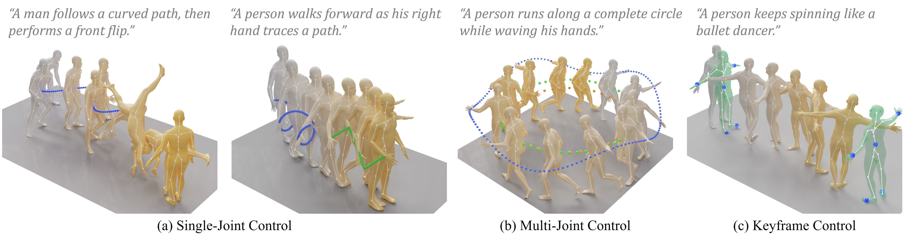

# Deli Cai — 个人主页

本站基于 [xbpeng/xbpeng.github.io](https://github.com/xbpeng/xbpeng.github.io) 模版搭建。
`css/main.css` 与模版逐字节一致，HTML 只做了「替换文字」和「删除原作者内容」两类改动。

## 目录结构

```
_config.yml              站点标题、描述、网址
index.html               首页（个人简介 + 论文列表，论文直接写在里面）
_includes/               页面片段
  meta.html                <meta> 标签（分享预览、Google Scholar 抓取）
  small_image.html         自动查找 xxx_small.jpg 缩略图
  icon.html                按钮上的小图标
_layouts/
  default.html             全站外框（顶部导航在这里）
  project.html             单篇论文详情页的外框
css/main.css             全部样式（与模版完全一致，含深色模式）
images/cmc.jpg           首页照片占位图
docs/Deli_Cai_CV.pdf     CV，首页 “CV” 按钮指向它
projects/<论文名>/        每篇论文一个目录（含 index.html 和 cmc.jpg 占位图）
```

## 常见修改

### 改论文列表
**直接编辑 [index.html](index.html)** 的 Publications 那一段。每篇论文就是一个 `<article class="pub">` 区块，
标题、作者、venue 都是明写的文字，改哪改哪：

```html
<article class="pub">
	<a class="pub-thumb" href="projects/StereoGS/index.html"></a>
	<div class="pub-info">
		<a class="pub-title" href="projects/StereoGS/index.html">StereoGS: Sparse-View 3D Gaussian Splatting via Stereo Prior</a>
		<div class="pub-authors">Wenhao Yuan, Yiyuan Ge, <b>Deli Cai</b></div>
		<div class="pub-venue">European Conference on Computer Vision (ECCV) 2026</div>
		<div class="pub-links">
			<a class="pill" href="projects/StereoGS/index.html">Project page</a>
		</div>
	</div>
</article>
```

要点：

- **加论文**：整段复制一份，改标题、作者、venue 和三个 `projects/...` 路径。
- **加粗自己的名字**：用 `<b>Deli Cai</b>` 包起来。
- **年份分组**：`<h3 class="year">2026</h3>` 这样的小标题，想调顺序就连着下面的区块一起挪。
- `<a class="pill" ...></a>` 那行是「Project page」按钮，`` 是图标，别单独删掉里面那截。
- ⚠️ **没有自动检查了**：以前论文列表由 yml 驱动，名字写错会显示红色提示；
  现在改成手写，如果 `href`/`src` 指向的目录不存在，点击会直接 404。
  加论文时记得在 `projects/` 下建好同名目录。

### 改首页简介文字
同样在 [index.html](index.html)，最上面 `<section class="intro">` 里。

### 改站点标题和描述
编辑 [_config.yml](_config.yml)。`description` 会出现在搜索结果和分享卡片里。

### 替换图片
- **某篇论文的图**：直接覆盖 `projects/<论文名>/cmc.jpg` 这个文件，**文件名不用改**。
- **首页照片**：覆盖 `images/cmc.jpg`。
- 想换成别的文件名，就把 `index.html` 里对应那处 `src="..."` 一起改掉。

### 补充论文详情页的摘要 / PDF / BibTeX
编辑 `projects/<论文名>/index.html` 的 front matter（开头 `---` 之间的部分），
里面留好了注释示例，把 `#` 去掉填入内容即可：

```yaml
paper: "StereoGS_2026.pdf"     # 把 PDF 放进同一目录，Paper 按钮会自动出现
abstract: >-
  摘要正文。想分多段就用单独一行 | 分隔。
bibtex: |
  @inproceedings{...}
```

**填了才显示，没填就不显示** —— 不会在页面上留下空的 Abstract 标题或空 BibTeX 框。

### 改顶部导航
编辑 [_layouts/default.html](_layouts/default.html)。目前只有「Home」一项，
因为模版原有的 Team / Teaching / Art 三个页面属于原作者、已经删除。

## 本地预览

需要 Ruby + Jekyll（RubyInstaller，安装时勾选 DevKit）：

```bash
gem install jekyll bundler
cd E:/projects/personal_page
jekyll serve
```

然后打开 http://localhost:4000 。**不要**直接双击 `index.html` —— 它是 Jekyll 源文件，
直接打开只会看到没处理过的模板文字，不是网页。

## 部署

推送到 `master` 分支后，在仓库 **Settings → Pages** 里把 Source 设为 `Deploy from a branch`，
分支选 `master`、目录选 `/ (root)`。站点地址：<https://cdlchoi.github.io>

构建失败时页面上不会有任何提示（只会一直 404），要去仓库的 **Actions** 标签页看
`pages-build-deployment` 的日志。

## 还没填的内容

- **首页照片**：现在用的是论文占位图。模版 `.intro-photo` 固定 150px 宽、高度自适应，
  `cmc.jpg` 是 4685×1257 的横长图，会显示成一条细带。**换一张竖版证件照即可正常显示。**
- **论文摘要、PDF、BibTeX**：五篇都还没填。
- **两篇待投稿论文（2027）的作者列表**：CV 里只写了合作者、没有确定作者顺序，所以首页和详情页都留空了。
- **Google Scholar / ORCID / X 等链接**：CV 里没有，所以没加。有的话加到首页 `profile-links` 里。

## 与模版代码的差异

除了替换文字，只做了这些：删除原作者的 Team / Teaching / Art 导航、Codebase 和 Thesis 面板、
Prospective students 按钮、Twitter 账号和 Google Analytics 统计代码；
并把论文列表从「yml + 循环」改成手写（见上）。另外为了让没填的字段不产生空标题，
加了几处 `` 判断（模版本身就有 `` 这类写法，风格统一）：

| 文件 | 改动 |
| --- | --- |
| `_layouts/project.html` | Paper 按钮、Abstract 分区、BibTeX 分区各包一层 `` |
| `_includes/meta.html` | `citation_pdf_url` 包一层 ``；年份改为从 venue 文字里提取，不再依赖 yml |

被删掉的两个模版文件（`_data/publications.yml`、`_includes/publication.html`）
可以用 `git show 9733d2f:_data/publications.yml` 找回。

排版、class、CSS 均未改动。
